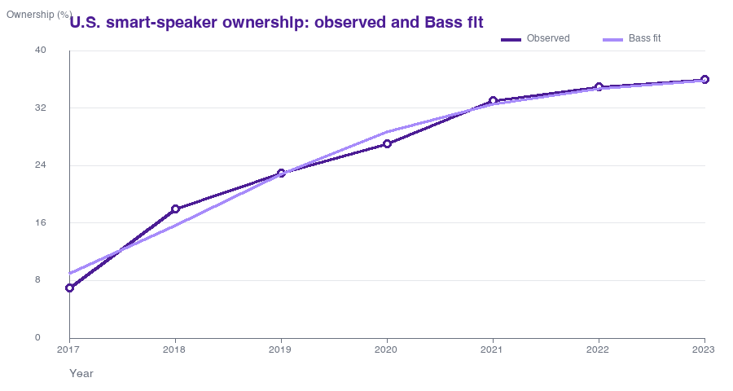
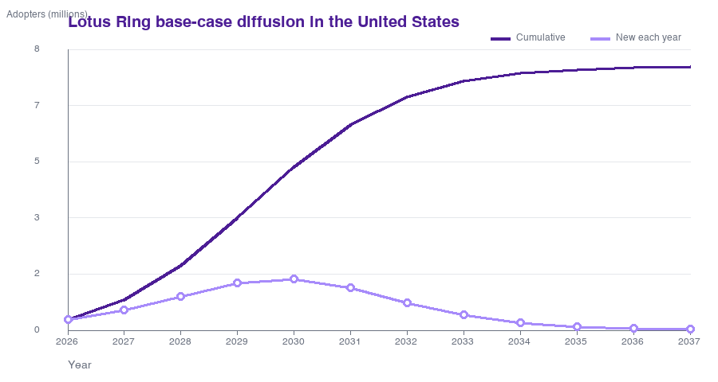

# Lotus Ring Diffusion Forecast Using the Bass Model

**Course assignment:** Innovation Diffusion Analysis  
**Selected innovation:** Lotus Ring  
**Scope:** United States  
**Date:** October 15, 2026

## Executive summary

The Lotus Ring is a wearable remote for home controls. A user points the ring at a Lotus Switch Cover and presses a button to operate a light switch or another supported object. The main benefit is independence: the system works without an app, Wi-Fi, or rewiring, which makes it especially relevant for people with limited mobility [1, 2].

I used U.S. smart-speaker ownership as the historical look-alike. Smart speakers are not physically identical to the Lotus Ring, but the adoption decision is similar. Both products let a person control things at home with less movement, and both depend on compatible home devices. The fitted Bass parameters are **p = 0.0280**, **q = 0.7343**, and **M = 36.88% of the U.S. population age 12+**. Using Edison's 2023 estimate, this M is about **105.5 million people**. The fit has an RMSE of **1.36 percentage points** and an R-squared of **0.981** [3].

For the Lotus Ring, I estimated a serviceable U.S. market of **8.0 million adopters**. This is a Fermi estimate based on the U.S. adult population, the CDC mobility-disability rate, and a conservative 25% serviceable share. Transferring the fitted p and q to this market gives a base-case peak in annual adoption around **2029-2030**. Cumulative adoption reaches about **4.95 million by 2030** and **7.90 million by 2035**. These values are a scenario, not company sales guidance.

## 1. Selected innovation: Lotus Ring

TIME included the Lotus Ring in its Best Inventions of 2025 list and described it as a "point-and-click smart-home ring" [1]. The rechargeable ring sends an infrared signal to specialized covers that physically flip switches. TIME reports four to six months of battery life and notes that the system does not require rewiring or an app [1].

The company's site describes the basic process as putting on the ring, snapping a magnetic cover onto a switch, and pointing and clicking [2]. As of October 15, 2026, the starter kit with one ring and three switch covers is listed at **$499**. The company also says the system is private and offline, the ring is IPX8 waterproof, and the devices need charging only a few times per year [2].

## 2. Historical look-alike: smart speakers

I chose smart speakers, especially devices such as Amazon Echo, as the look-alike innovation. A smart speaker gives a simple command interface for the home and can control compatible lights, thermostats, and other devices. The Lotus Ring solves a similar job with a pointing gesture and a physical click instead of voice. Both reduce the need to walk to a switch or use a phone. They also become more useful when more compatible devices are installed in the home.

There are important differences. A smart speaker uses Wi-Fi, cloud services, and voice recognition, while Lotus intentionally avoids those requirements. Lotus is also positioned first as assistive technology, not as a general entertainment device. Still, smart speakers are a better comparison than ordinary jewelry or fitness rings because the core adoption decision is about a new interface for controlling the home. Amazon announced the first Echo in November 2014, so I use 2014 as t = 0 for the comparison series [7].

## 3. Historical data and scope

Edison Research's Infinite Dial 2023 report gives a consistent U.S. time series for the share of the population age 12+ owning a smart speaker [3]. The values are 7% in 2017, 18% in 2018, 23% in 2019, 27% in 2020, 33% in 2021, 35% in 2022, and 36% in 2023. The report estimates 103 million owners in 2023 [3].

| Year | t since 2014 | Ownership of U.S. population age 12+ |
|---:|---:|---:|
| 2017 | 3 | 7% |
| 2018 | 4 | 18% |
| 2019 | 5 | 23% |
| 2020 | 6 | 27% |
| 2021 | 7 | 33% |
| 2022 | 8 | 35% |
| 2023 | 9 | 36% |

I use a U.S. scope for three reasons. First, the public historical series is nationally representative for the United States. Second, Lotus currently lists the product in U.S. dollars and shows a United States storefront [2]. Third, switch formats, pricing, reimbursement, and distribution can differ across countries, so a global forecast would add assumptions that are hard to defend.

## 4. Bass model and estimation

The Bass model separates adoption into innovation and imitation effects. The cumulative number of adopters at time t is:

**N(t) = M x [1 - exp(-(p + q)t)] / [1 + (q/p)exp(-(p + q)t)]**

Here, p is the coefficient of innovation, q is the coefficient of imitation, and M is the eventual market potential [4]. I estimated the three parameters by nonlinear least squares, minimizing the squared difference between the observed and fitted ownership percentages.

| Parameter | Estimate | Interpretation |
|---|---:|---|
| p | 0.0280 | Adoption caused by outside influence or independent trial |
| q | 0.7343 | Adoption associated with imitation and word of mouth |
| M | 36.88% | Long-run smart-speaker ownership potential in the fitted population |
| M, normalized | 105.5 million | 36.88% scaled from Edison's 103 million at 36% in 2023 |
| RMSE | 1.36 percentage points | Typical fitting error across the seven observations |
| R-squared | 0.981 | Share of variation explained by the fitted curve |

The q estimate is much larger than p. In this model, that means social proof and learning from other users matter more than completely independent adoption. This seems reasonable for a home-control product because potential buyers benefit from demonstrations, reviews, and recommendations.

## 5. Lotus Ring market potential

Lotus does not publish a long sales history, so I used Fermi logic for M. The 2024 U.S. population was 340.1 million and 21.5% were under age 18, giving about **267.0 million adults** [5]. The CDC reports that **12.2% of U.S. adults** had a mobility disability in 2022 [6]. Multiplying those figures gives a broad need-based pool of about **32.6 million adults**.

The full 32.6 million is too high for a serviceable market. Some people will not need this exact product, some homes will not be compatible, several users may live in one household, and the current $499 price is a real barrier. I therefore use **25% of the need-based pool** as a base assumption. This gives 8.15 million, which I round down to **M = 8.0 million adopters**. The 25% is my modeling assumption, not a measured market share.

| Fermi step | Calculation | Result |
|---|---:|---:|
| U.S. adults | 340.1m x (1 - 21.5%) | 267.0m |
| Adults with mobility disability | 267.0m x 12.2% | 32.6m |
| Serviceable share assumption | 32.6m x 25% | 8.15m |
| Rounded market potential | Conservative round-down | 8.0m |

## 6. Lotus Ring diffusion forecast

I transfer p and q from the smart-speaker model and replace M with the 8.0 million Lotus market estimate. The forecast starts in 2026, the first full year after the product's 2025 recognition by TIME.

| Year | New adopters (millions) | Cumulative adopters (millions) | Market penetration |
|---:|---:|---:|---:|
| 2026 | 0.322 | 0.322 | 4.0% |
| 2027 | 0.610 | 0.932 | 11.7% |
| 2028 | 1.028 | 1.961 | 24.5% |
| 2029 | 1.436 | 3.396 | 42.5% |
| 2030 | 1.554 | 4.950 | 61.9% |
| 2031 | 1.280 | 6.230 | 77.9% |
| 2032 | 0.838 | 7.068 | 88.4% |
| 2033 | 0.469 | 7.538 | 94.2% |
| 2034 | 0.240 | 7.778 | 97.2% |
| 2035 | 0.117 | 7.895 | 98.7% |
| 2036 | 0.056 | 7.951 | 99.4% |
| 2037 | 0.026 | 7.977 | 99.7% |

The curve rises quickly after 2027 and annual adoption peaks around 2030. In practice, reaching this path would require wider distribution, strong demonstrations through occupational therapists and disability organizations, and either lower prices or reimbursement support. Lotus's offline design could help people who are concerned about privacy, but the need for proprietary switch covers may slow adoption compared with software-based smart-home systems.

## 7. Sensitivity and limitations

The largest uncertainty is M, not the equation. If the serviceable market were only 4 million people, the model would predict about 2.47 million cumulative adopters by 2030. If M were 12 million, the same timing parameters would predict about 7.42 million by 2030. The base case is exactly between those values because the Bass curve scales linearly with M when p and q stay fixed.

There are also limitations in transferring p and q. Smart speakers were cheaper, served a wider set of uses, and were backed by large technology companies. Lotus is a more focused assistive device. The historical series measures ownership percentages rather than first-purchase sales, and it begins three years after the 2014 launch. Finally, the 25% serviceable share is a transparent assumption, not observed demand. For these reasons, I would use the forecast as a planning range rather than a precise sales target.

## Conclusion

The comparison suggests that the Lotus Ring can have a strong imitation effect if users can see the product working in real homes. The base model estimates p = 0.0280 and q = 0.7343, with an 8.0 million U.S. market potential. Under those assumptions, cumulative adoption approaches 5 million by 2030 and the annual adoption peak occurs around 2029-2030. The result is most sensitive to affordability, distribution, and how much of the mobility-limited population finds the switch-cover system useful.

## References

1. Stokel-Walker, C. (2025, October 9). "Lotus Ring." *TIME Best Inventions 2025*. https://time.com/collections/best-inventions-2025/7318226/lotus-ring/
2. Lotus. (2026). "Lotus is a wearable ring that controls objects at home by pointing." Accessed October 15, 2026. https://getlotus.com/
3. Edison Research. (2023). *The Infinite Dial 2023*. Smart Speaker Ownership, U.S. population age 12+. https://www.edisonresearch.com/wp-content/uploads/2023/03/The-Infinite-Dial-2023.pdf
4. Bass, F. M. (1969). "A New Product Growth for Model Consumer Durables." *Management Science*, 15(5), 215-227. https://doi.org/10.1287/mnsc.15.5.215
5. U.S. Census Bureau. (2025). *QuickFacts: United States*. 2024 population estimate and persons under age 18. https://www.census.gov/quickfacts/fact/table/US/PST045225
6. Centers for Disease Control and Prevention. (2024). *Disability: PLACES measure definitions*. 2022 U.S. adult disability prevalence. https://www.cdc.gov/places/measure-definitions/disability.html
7. Eadicicco, L. (2014, November 6). "Amazon Unveils Siri-Like Speaker You Control With Your Voice." *TIME*. https://time.com/3562932/amazon-echo/
